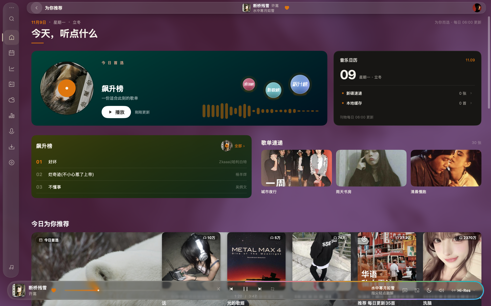
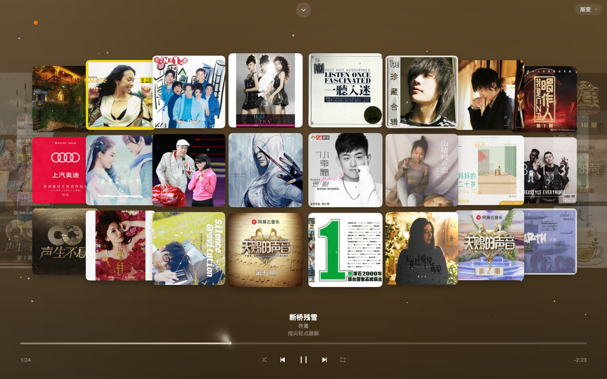

<div align="center">

# Echo 云音乐

### Music Reimagined // 回声新境

简体中文 | [English](README.en.md)

<br>


<br>


<br>

[获取方式](#获取方式) · [四家平台](#四家平台) · [使用指南](#使用指南) · [常见问题](#常见问题) · [技术说明](#技术说明) · [致谢与声明](#致谢与声明)

</div>

---

## 项目简介

一个用 **Go** 与 [MyGo](https://github.com/egoist/mygo) 写成的桌面音乐客户端：**原生界面，没有 WebView**，冷启动不到一秒。在 [mygo-cloudmusic](https://github.com/egoist/mygo-cloudmusic) 基础上独立演进，加上了自己的理解——**液态玻璃**、**黑胶唱机**、**逐字歌词**、**听歌周报**、**天气电台**、**下载管理**，以及 0.4.2 起可以一起用的**四家平台**。

<div align="center">

<br>



*首页 · 为你推荐与今日为你推荐*

<br>



*正在播放 · 拼贴纸墙，封面的颜色浸到背景里*

</div>

## 四家平台

网易云音乐、汽水音乐、酷狗音乐与 QQ 音乐都能登录，各自的歌单在侧栏分组列出；**搜索能四家一起搜**，**歌单还能从一个平台搬到另一个**。

| 平台 | 登录方式 | 读（歌单 / 播放 / 歌词） | 写（往歌单里加歌） |
|---|---|---|---|
| **网易云音乐** | 扫码 | ✅ | ✅ 新建歌单、加歌 |
| **汽水音乐** | 扫码 | ✅ | ✅ 加到已有歌单 |
| **酷狗音乐** | 扫码 | ✅ | ❌ 第三方接口只有读 |
| **QQ 音乐** | **QQ 扫码 / 微信扫码** | ✅ | ❌ 第三方接口只有读 |

> 汽水 / 酷狗 / QQ 的登录与取流由内置的 Node 桥接进程完成（这几家的签名无法在 Go 侧复现），所以**用到这三家时要先装 Node.js**；只用网易云则不需要。
>
> 歌单搬运目前的目标是**网易云（新建）**与**汽水音乐（选已有歌单）**——写着 ❌ 的几家，第三方接口没有"往歌单加歌"的能力。

## 这一版做了什么（0.4.2）

- **QQ 音乐**：接入第三方接口，支持 **QQ 扫码与微信扫码**两条通道，歌单、播放与歌词一并打通
- **跨音源搜索**：搜索页多一行「来源」，网易云 / 汽水 / 酷狗 / QQ 各搜各的曲库，没登录的那家点进去就地登录
- **歌单搬运**：把正在看的歌单搬到网易云或汽水音乐，按「歌名 + 歌手」在目标平台找对应版本，找不到的会如实报「N 首没找到」，不拿别的歌顶上
- **十段均衡器**：31Hz 到 16kHz 逐段调，另有流行 / 摇滚 / 古典 / 低音增强 / 人声等预设；抬起来的频段会自动留出余量，不削波
- **账号菜单**：每家都有「我的主页」（与网易云那页同一套布局），切换常用账号改成点整行
- **登录态双写**：除了系统钥匙串，还存一份在本机——**重新安装不用再扫码**

完整的版本记录见 [CHANGELOG.md](CHANGELOG.md)。

## 完整功能

- **四家平台**一起用：各自的歌单分组、跨音源搜索、歌单搬运
- 扫码登录，登录态保存在系统凭据存储中（并留一份在本机）
- 每日推荐、推荐歌单、排行榜、我的歌单、新碟速递
- 搜索单曲、歌手、专辑、用户与播客，输入时显示搜索建议，保留搜索历史
- 歌手页的热门与最新歌曲、专辑与动态，关注歌手；专辑页与用户页
- 私人 FM（推荐 / 熟悉 / 探索）与心动模式
- 边下边播，标准 / 较高 / 极高 / 无损（FLAC）/ Hi-Res
- 听过的歌曲缓存在本机，再次播放无需等待；下载管理可看占用、单删、一键清空
- **十段均衡器**、音量均衡，暂停与继续时淡出淡入
- 退出后再打开，从上次的播放队列与进度继续
- 逐字歌词与翻译，正在播放页的「律动」视图与歌曲评论
- 液态玻璃、黑胶唱机、拼贴纸墙、听歌周报、天气电台、睡眠定时器
- 浅色 / 深色 / 跟随系统

## 获取方式

前往 [Releases](https://github.com/Simqiqi/Echo-music/releases/latest) 下载，或一行命令装好（装到用户目录，之后自动更新）：

**macOS / Linux**

```bash
curl -fsSL https://simqiqiecho.dpdns.org/install.sh | sh
```

**Windows（PowerShell）**

```powershell
irm https://simqiqiecho.dpdns.org/install.ps1 | iex
```

也可以直接下载安装包：macOS 的 `.dmg`（Apple Silicon 与 Intel 各一份）、Windows 的 `setup.exe`、Linux 的 `.deb` 与 `.tar.gz`。

> **macOS 提示「已损坏，无法打开」？** 这是未做公证的下载被系统打上了隔离标记，不是文件坏了：
>
> ```bash
> xattr -dr com.apple.quarantine /Applications/Echo云音乐.app
> ```

## 使用指南

首次打开需扫码登录，登录态由系统钥匙串安全存储。登录后即可浏览每日推荐、搜索歌曲、创建歌单。

- **换平台**：点右上角头像 → 在对应那一行点「登录」；登录过的平台会出现在侧栏分组里
- **搜索别家**：进搜索页后，标题下方那行「来源」可以切换平台；没登录的点进去就地登录
- **搬运歌单**：打开一个歌单 → 菜单「文件」→「搬运当前歌单到网易云 / 汽水音乐…」

更多细节见 [CHANGELOG.md](CHANGELOG.md)。

## 常见问题

**为什么汽水 / 酷狗 / QQ 的登录要装 Node.js？**
这三家的登录签名与取流无法在 Go 侧复现，由随包的 Node 桥接进程完成。装好 Node.js（≥ 20）后自动使用；只用网易云不需要它。

**有些歌为什么播不了，或者只能播一小段？**
平台侧的版权与会员限制：QQ 音乐的 320kbps / 无损与酷狗的部分曲目需要会员，未开通时会自动降到 128kbps 能听的那一档，实在没有可播版本就如实提示「需要会员或没有版权」。

**重新安装后要重新扫码吗？**
不用。登录态除系统钥匙串外还存了一份在本机（仅本用户可读），重新安装后会自动恢复。

## 技术说明

### 目录结构

| 目录 | 放什么 |
|---|---|
| `main.go` | 入口，把窗口交给 `internal/app` |
| `internal/app/` | 界面与交互：页面、组件、动效的驱动，以及设置、缓存策略、更新检查 |
| `internal/fx/` | 真正在 GPU 上跑的特效与配色：星空、地形、涟漪、黑胶、水彩，以及共用的 HSV 换算 |
| `internal/player/` | 解码与播放：队列、跳转、淡入淡出、缓存、十段均衡器、切歌过渡 |
| `internal/netease/` | 网易云接口：eapi 加密、扫码登录、目录与搜索、动态与新碟、播放地址 |
| `internal/qishui/` `internal/kugou/` `internal/qq/` | 三家桥接音源的薄封装（登录、歌单、搜索、播放地址、歌词） |
| `internal/sidecar/` | 与 Node 桥接进程对话、找 Node 与随包脚本 |
| `internal/secretstore/` | 登录态：系统钥匙串 + 本机文件（重装不掉线） |
| `internal/lyrics/` | 歌词解析（含逐字与翻译） |
| `sidecar/` | Node 桥接进程：三家平台的扫码登录、签名、取流与必要转码 |
| `website/` | 官网（TanStack Start + Solid，部署到 Cloudflare） |

### 从源码构建

需要 **Go 1.27+**；要给桥接音源打包，另需 Node.js。

```bash
go tool mygo dev     # 开发模式运行
go tool mygo build   # 打包到 build/
go test ./internal/...   # 运行测试
```

### 演进方向

本仓库自 2026 年 11 月起独立演进，不再合并原项目的提交。界面与功能的改动集中在 `internal/app/`，特效在 `internal/fx/`，播放器的扩展在 `internal/player/`，音源接入在 `internal/{netease,qishui,kugou,qq}/` 与 `sidecar/`。

<div align="center">

<br>

[](https://star-history.com/#Simqiqi/Echo-music&Date)

</div>

## 致谢与声明

### 致谢

- [mygo-cloudmusic](https://github.com/egoist/mygo-cloudmusic)：本项目的起点，客户端主体功能由其实现
- [MyGo](https://github.com/egoist/mygo)：原生 UI 与应用框架
- [Remix Icon](https://remixicon.com/)：应用内图标（[Apache-2.0](https://www.apache.org/licenses/LICENSE-2.0)）
- [NeteaseCloudMusicApi](https://github.com/Binaryify/NeteaseCloudMusicApi)：eapi 加密与登录流程的参考
- [folia-major](https://github.com/chthollyphile/folia-major)：歌词动画效果的参考
- [qishui-music-api](https://www.npmjs.com/package/qishui-music-api)、[kugoumusicapi](https://www.npmjs.com/package/kugoumusicapi)、[@sansenjian/qq-music-api](https://www.npmjs.com/package/@sansenjian/qq-music-api)：汽水 / 酷狗 / QQ 音乐接入时使用的第三方库

### 来源与修改声明

本项目基于 [egoist/mygo-cloudmusic](https://github.com/egoist/mygo-cloudmusic)（AGPL-3.0）二次开发。原项目及其全部贡献者的著作权归其各自作者所有；本仓库保留原始许可证与版权声明，并按 AGPL-3.0 第 5 条注明：本仓库自 2026 年 10 月起对界面布局、播放动效、应用标识与代码结构做了修改，具体版本记录见 [CHANGELOG](CHANGELOG.md)。

本项目与各家音乐平台官方无关，音乐版权归各权利人所有。

## 许可证

[AGPL-3.0](LICENSE)
